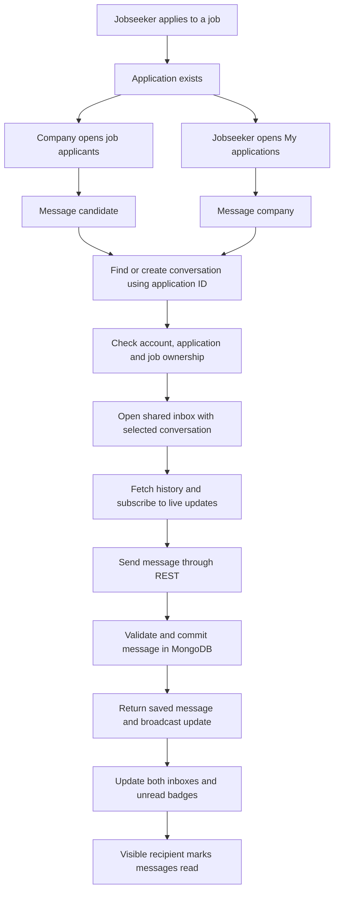
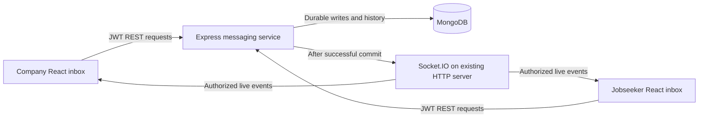
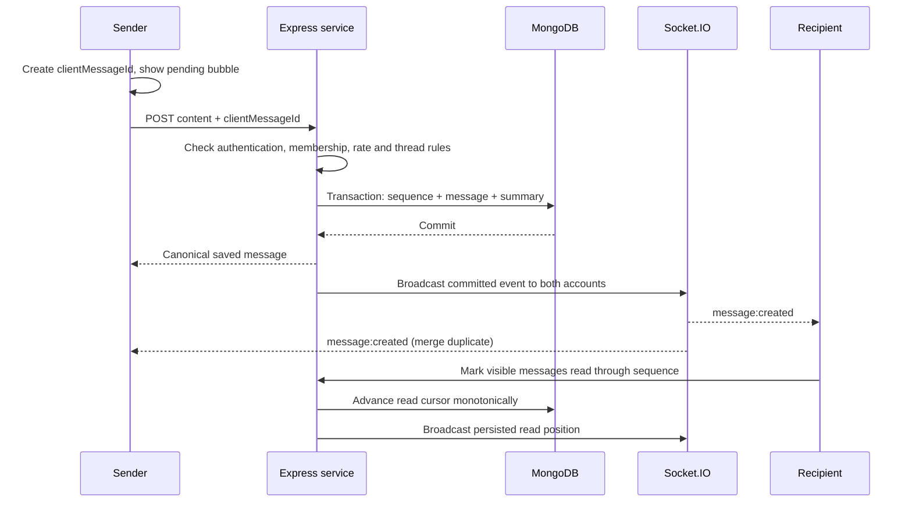

# Company ↔ Jobseeker messaging plan

Status: proposed implementation plan. No messaging backend is implemented by this document.

## 1. Recommended first release

Build private, one-to-one conversations between a jobseeker and the company account that posted a job. Link each conversation to an existing application. Either participant can start the conversation after the application exists.

Use the existing React, Redux Toolkit, Express, MongoDB and JWT setup. Attach Socket.IO to the existing HTTP server. Keep MongoDB as the durable source of truth and use REST for writes/history, with Socket.IO for live updates.

**Redis is not required for the first release on one backend instance.** Use an in-memory frontend query cache. Add shared infrastructure when deployment or measured performance requires it; caching and durable message storage are different concerns.

Initial scope:

- Text messages in both directions, up to 2,000 characters.
- Conversation list, search, message history and cursor pagination.
- Unread badges, read receipts, typing indicator and connection status.
- Pending, saved and failed send states with retry.
- Responsive inbox with loading skeletons and empty/error states.
- Application and job context in every conversation.

Defer attachments, group chats, voice/video calls, message editing/deletion, push/email notifications and unrestricted company discovery chat. These can be added after reliable text messaging works.

## 2. What exists in this project

| Area | Current state | Planned change |
| --- | --- | --- |
| Company inbox | `frontend/src/pages/company/CompanyMessages.jsx` uses sample conversations and local state | Replace preview data with authenticated API data |
| Company route | `/company/messages` already exists | Keep route and workspace layout |
| Jobseeker inbox | No messages route/sidebar item | Add `/jobseeker/messages` and unread badge |
| Company applicants | Backend has `GET /applications/:id/applicants`, where `id` is a job ID | Add an applicants screen and Message candidate action |
| Applied jobs | Jobseeker application history exists | Add Message company action using application ID |
| Realtime | Backend already depends on `socket.io`, but server does not initialize it | Attach Socket.IO to `server` in `backend/server.js` |
| Frontend transport | No Socket.IO client dependency | Add a compatible `socket.io-client` 4.x version |
| Database | User, Company, Job and Application models exist | Add Conversation and Message collections |
| Authentication | JWT middleware checks live account role and suspension | Share this validation with socket authentication |
| Query cache | Redux Toolkit and redux-persist already exist | Add RTK Query; exclude chat API state from persistence |

Company identity must come from `Job.postedBy`, which references a **User account**. A Company profile document is display/context information, not the authenticated recipient. Also verify that `Job.company.createdByUserId` agrees with the job owner before creating a conversation. Do not let clients choose arbitrary participants.

The admin contact inbox is for website enquiries. Private chat must remain separate; general admin management access must not automatically expose private conversations.

## 3. User flow

### Company

1. Open Jobs → a job → Applicants.
2. Click Message candidate beside an applicant.
3. Server derives participants from the application and job, then returns the existing conversation or creates one.
4. Navigate to `/company/messages?conversation=<id>`.
5. Show candidate name, job title and application context; load real history.
6. Replies appear live. Messages sidebar badge reflects unread messages across conversations.

### Jobseeker

1. Open My applications → Message company.
2. Server performs the same authorization and conversation lookup.
3. Navigate to `/jobseeker/messages?conversation=<id>`.
4. Show company profile name/logo and the relevant job.
5. Send replies and return to the thread from the Messages sidebar.

### Proposed conversation rules

- One conversation per application, enforced by a unique database index. Multiple applications to different jobs can produce separate threads with the same company.
- Only the applicant and posting company account can read or send.
- Rejected applications retain follow-up messaging; application status does not silently delete history.
- Soft-deleted jobs retain history but make the thread read-only, with a clear reason.
- Suspended/deleted participants cannot send. Preserve history for the remaining authorized participant according to the retention policy.
- Legacy jobs with a missing, unsupported or inconsistent company owner cannot start a new thread. Show an unavailable-company state; never guess another recipient.
- No automatic admin participant. Future reported-message review requires explicit permissions, scope and an audit trail.

These are recommended product rules for implementation, rather than existing behavior.

## 4. Architecture and dependencies

| Tool | Purpose | Needed initially? |
| --- | --- | --- |
| MongoDB + Mongoose | Conversations, messages, read positions and indexes | Yes; already used |
| Express | Authorized REST endpoints and one shared messaging service | Yes; already used |
| Socket.IO server | Live notifications and ephemeral typing events | Yes; already installed |
| `socket.io-client` | Browser realtime connection | Add to frontend |
| RTK Query | History/list fetching, optimistic updates and in-memory cache | Use existing Redux Toolkit package |
| Rate limiter | Per-account and per-conversation send limits | Add or implement a bounded single-instance limiter |
| Redis + Socket.IO adapter | Cross-instance broadcast, shared presence/rate limits | Later, when deploying multiple instances |

Use one authenticated socket connection per browser tab, owned by a shared provider/service. Avoid creating a connection for every conversation or component. Clean up listeners correctly, including React Strict Mode mounts.

RTK Query supports applying streaming events to query caches. Use APIs available in the installed Redux Toolkit version, with ordinary cursor queries if necessary; do not assume newer infinite-query features exist. See [RTK Query streaming updates](https://redux.js.org/toolkit/rtk-query/usage/streaming-updates).

## 5. Database design

### Conversation

| Field | Purpose |
| --- | --- |
| `applicationId` | Unique reference to the application |
| `jobId`, `companyId` | Context references |
| `companyUserId`, `jobseekerUserId` | Fixed authorized account participants |
| `lastSequence` | Server-assigned message sequence within this conversation |
| `lastMessageId`, `lastMessageAt`, `lastMessagePreview` | Inbox summary, updated with the message write |
| `companyLastReadSequence`, `jobseekerLastReadSequence` | Monotonic per-participant read cursors; initially zero |
| `createdAt`, `updatedAt` | Server timestamps |

Keep authorization tied to immutable participant account IDs. Resolve current job/account availability on sensitive actions instead of trusting a stale cached writable flag. If snapshotting job/company labels for historical context, clearly distinguish snapshots from current profile data.

Indexes: unique `applicationId`; `(companyUserId, lastMessageAt desc, _id desc)`; `(jobseekerUserId, lastMessageAt desc, _id desc)`.

### Message

| Field | Purpose |
| --- | --- |
| `conversationId` | Parent conversation |
| `senderId` | Set from authenticated account, never from request data |
| `sequence` | Increasing server-assigned conversation position |
| `clientMessageId` | UUID generated once per send attempt, reused on retries |
| `content` | Validated plain text, maximum 2,000 characters |
| `createdAt` | Server timestamp |

Indexes: unique `(conversationId, sequence)`; unique `(conversationId, senderId, clientMessageId)`; `(conversationId, senderId, sequence)` for unread queries. Never embed an unlimited messages array inside a conversation.

Initially calculate unread counts from messages sent by the other participant after the account's read cursor. Do not count the user's own messages. Avoid reset-to-zero counters that race with arriving messages. Optimize with transactional counters only if profiling justifies it.

### Atomicity and migration prerequisites

Use a MongoDB transaction for sequence allocation, message insertion and conversation summary updates. Return success and emit events only after commit. Verify that the actual deployment supports transactions: use a replica set or supported sharded deployment, not an unconfigured standalone development server. See [MongoDB transactions](https://www.mongodb.com/docs/manual/core/transactions/).

Before adding a unique `(job, applicant)` index to Applications, audit existing duplicate applications and choose a migration strategy. Current application creation checks for duplicates in application code but has no compound unique index. Do not delete existing duplicates automatically. Concurrent conversation creation must also recover from a duplicate-key race by returning the existing thread.

## 6. REST API contract

Mount a new authenticated router at `/conversations`. Each endpoint checks membership; role alone is insufficient.

| Method and endpoint | Behavior |
| --- | --- |
| `POST /conversations` | Body `{ applicationId }`; authorize and return/create thread idempotently |
| `GET /conversations?cursor=&limit=20&search=&unreadOnly=` | Participant-only inbox, stable cursor ordering by last activity and ID |
| `GET /conversations/unread` | Account-wide unread summary for navigation badges |
| `GET /conversations/:id/messages?beforeSequence=&limit=30` | Older history, bounded page size |
| `GET /conversations/:id/messages?afterSequence=&limit=100` | Reconnect catch-up; fetch successive pages until complete |
| `POST /conversations/:id/messages` | Body `{ content, clientMessageId }`; canonical message write path |
| `PATCH /conversations/:id/read` | Body `{ throughSequence }`; monotonic update, bounded by persisted history |

Return canonical message ID, clientMessageId, sequence, sender and timestamp after saving. Sort rendered messages by sequence. Reject requests that combine incompatible history cursors. Apply a consistent error format for validation, expired authentication, forbidden/not-found access, read-only threads and rate limiting.

Retrying an already committed `clientMessageId` must return the original message without allocating another sequence or incrementing unread state. Reject reuse of the same ID with different content. Handle duplicate-key errors outside an aborted transaction and fetch the original authorized message.

Search is over authorized inbox metadata, not public users. Bound search length, escape search patterns and avoid arbitrary regex input. Full message search can wait.

## 7. Socket events and authentication

Authenticate the handshake with the existing JWT supplied in Socket.IO's `auth` payload, not a URL query string. Share the live account/role/suspension validation used by REST. Configure Socket.IO origin handling explicitly; Express CORS does not configure sockets automatically.

After authentication, join a server-controlled `user:<accountId>` room. This lets every tab belonging to each participant receive message, read and inbox updates. Never let a client join arbitrary account rooms.

| Event | Direction | Purpose |
| --- | --- | --- |
| `message:created` | Server → participant account rooms | Canonical committed message |
| `conversation:updated` | Server → participant account rooms | Inbox summary changed; refresh unread as needed |
| `conversation:read` | Server → participant account rooms | Persisted participant read position |
| `conversation:join` / `conversation:leave` | Client → server | Authorized active-thread subscriptions for typing |
| `typing:start` / `typing:stop` | Client ↔ server | Throttled, short-lived indicator to the other participant |

Authorize every room join and typing event. For writes, REST rechecks current account state and thread rules. Disconnect expired sessions, clear typing on disconnect, and disconnect suspended accounts when suspension is applied. Reconnect must authenticate again. Do not rely on a successful handshake forever.

Use union-room broadcasts or one clear event path to avoid delivering duplicate events through both user and conversation rooms. Clients still deduplicate by canonical message ID/clientMessageId.

Presence is optional for release one. If included, count all active sockets for an account: closing one tab must not mark an account offline while another remains connected. Online status must not imply a message was read.

## 8. Reliable send, retry and reconnect flow

The HTTP response and socket event can arrive in either order. Merge both into one bubble; do not append blindly. A timeout after a successful database commit should be safely retryable with the same UUID.

Socket.IO defaults to at-most-once arrival, so reconnecting alone is insufficient to recover missed messages. Persist before broadcasting and fetch missed history from MongoDB. See [Socket.IO delivery guarantees](https://socket.io/docs/v4/delivery-guarantees/).

On reconnect or window focus:

1. Reauthenticate and subscribe to live updates.
2. Buffer/merge live events while fetching thread changes after the last known sequence.
3. Fetch all catch-up pages, deduplicate and sort by sequence.
4. Refresh conversation list and unread totals, including threads created while offline.

If the server crashes between commit and broadcast, the message is still recoverable from history. Refetch on focus/reconnect and use a modest polling fallback while realtime is unavailable. A durable outbox can be added later for stronger immediate event/notification delivery requirements.

MVP send states: **pending**, **saved** (server committed), **failed** (retry available), **read** (recipient's persisted read cursor covers it). Do not display delivered/read ticks based only on a socket emit. Keep offline drafts in memory and require an explicit retry rather than silently promising durable offline sending.

## 9. Frontend and visual behavior

Reuse the current workspace design and global color tokens. Extract shared inbox components so company and jobseeker views remain consistent.

- Desktop: conversation list beside active thread; occupy available workspace height below its existing header, without another large Messages heading or footer gap.
- Scroll the list and history independently; keep thread header and compact composer visible.
- Mobile: list screen → selected thread with Back to inbox; do not squeeze two columns into a narrow viewport.
- Show context-specific empty states and a button to applications/applicants when no thread exists.
- Use skeleton list rows/bubbles during initial fetch; preserve current content during background refresh.
- Composer: auto-grow to a bounded height, Send button, disabled empty state, character limit and inline failed-send retry.
- Enter sends, Shift+Enter inserts a newline; respect IME composition. Provide accessible labels, keyboard focus and restrained live announcements.
- Mark read only when the thread is selected, the page is visible/focused, and messages have been displayed. Receiving a notification in another tab must not mark it read.
- Preserve scroll position when loading older messages. Auto-scroll for new messages only when already near the bottom or after the user's own send; otherwise show a new-message indicator.
- Use an in-memory per-thread draft map. Reset socket, drafts and query cache on logout/account change.
- Exclude chat cache from the existing redux-persist root configuration. Return private history with appropriate no-store HTTP caching headers; the intentional in-memory application cache is separate.

## 10. Is a caching system required?

| Layer | Recommendation | Reason |
| --- | --- | --- |
| MongoDB durable storage | Required | Messages must survive refresh, disconnect and restart |
| Frontend RTK Query memory cache | Recommended now | Avoid repetitive history fetches and merge realtime updates |
| Browser localStorage history cache | Avoid for initial release | Stale data and shared-device privacy concerns |
| Redis message/history cache | Not required initially | Indexed, paginated MongoDB queries are the starting point |
| Redis Socket.IO adapter | Add when running multiple backend processes/replicas | Relay realtime broadcasts across instances |
| Shared presence and rate limiting | Add with multiple instances | Process memory is not shared across servers |

A Redis adapter is primarily cross-server coordination, not durable chat storage. With multiple Socket.IO nodes, plan both an adapter and load-balancer session affinity when using HTTP long-polling. WebSocket-only transport changes the affinity requirement but removes polling fallback; do not select it just to bypass configuration. See [Socket.IO multiple-node deployment](https://socket.io/docs/v4/using-multiple-nodes/).

If later measurements show expensive repeated inbox queries, cache selected summaries with a short TTL and explicit invalidation. Never serve private results without checking the requesting account, and never make Redis the only copy of messages or read positions.

## 11. Security and operational requirements

- Recheck application/job ownership and conversation membership on every endpoint; prevent cross-account ID access.
- Render plain text safely; do not use raw HTML for message bodies.
- Validate IDs, body size, whitespace-only content, UUIDs, cursors and limits server-side.
- Rate-limit conversation creation, sends, typing events and expensive search requests. Return retry guidance on throttling.
- Use HTTPS/WSS in deployment. Apply explicit allowed-origin checks and authentication to socket connections.
- Do not log JWTs, message content or complete private payloads. Log request IDs, failure categories and latency.
- Record send failures, reconnects, duplicate retries, database latency and socket counts without private text.
- Define retention and account-deletion behavior before production. Preserve existing history deliberately rather than cascading accidental deletions.
- Keep attachments out of MVP; future uploads need private access controls, file validation, size limits and malware handling.

## 12. Suggested file changes

The following are planned paths, not files created by this planning task.

| Path | Responsibility |
| --- | --- |
| `backend/models/conversation.model.js` | Conversation schema and indexes |
| `backend/models/message.model.js` | Message schema and idempotency indexes |
| `backend/services/messaging.service.js` | Shared eligibility, transaction, read/unread logic |
| `backend/controllers/conversation.controllers.js` | HTTP input/output handling |
| `backend/routes/conversation.routes.js` | Authenticated messaging endpoints |
| `backend/socket/index.js` | Initialize socket server, rooms and events |
| `backend/middleware/auth.js` or extracted auth service | Reusable live JWT/account validation |
| `backend/server.js` | Attach Socket.IO and messaging router |
| `frontend/src/redux/messagesApi.js` | RTK Query endpoints and cache updates |
| `frontend/src/redux/store.jsx` | API reducer/middleware; exclude chat persistence |
| `frontend/src/components/messages/` | Shared inbox, thread, composer, skeletons and provider |
| `frontend/src/pages/company/CompanyMessages.jsx` | Company wrapper using real shared inbox |
| `frontend/src/pages/company/CompanyApplicants.jsx` | Owned-job applicants and Message candidate action |
| `frontend/src/pages/jobseeker/JobseekerMessages.jsx` | Jobseeker inbox wrapper |
| `frontend/src/components/layout/JobseekerLayout.jsx` | Messages navigation and unread badge |
| `frontend/src/pages/jobseeker/JobseekerApplications.jsx` | Message company action |
| `frontend/src/App.jsx` and existing company navigation | Routes and account-wide unread integration |
| `backend/tests/` | Membership, persistence, retries, unread and socket tests |

## 13. Implementation order

1. **Foundation:** settle the proposed eligibility rules; verify MongoDB transaction support; audit application duplicates; define schemas, indexes and payload contracts.
2. **Persistent API:** implement eligibility, participant checks, conversation creation, transactional sends, cursor history and read positions. Test before connecting realtime.
3. **Real inbox:** extract shared UI, add the jobseeker route, applicants entry point and application chat actions; replace all preview messages.
4. **Realtime:** authenticate sockets, emit after commit, merge updates, add typing, unread badges and multi-tab read synchronization.
5. **Recovery and polish:** retry/idempotency, reconnect catch-up, fallback refresh, skeletons, responsive layout and accessibility.
6. **Production readiness:** rate limits, privacy/retention policy, monitoring, deployment checks and acceptance tests.
7. **Optional later:** attachments, notifications, reporting/moderation, Redis adapter/shared state when scaling.

## 14. Acceptance checks

- Company and jobseeker in separate browser contexts can each start and reply to an eligible application thread.
- The same application always opens the same conversation, including simultaneous creation requests.
- Another company, another jobseeker, anonymous users and ordinary admin requests cannot read/join/send to the thread.
- Sender cannot spoof a user ID, company profile, timestamp or message sequence.
- Retrying after a lost response produces exactly one stored message and one UI bubble.
- Refresh, backend restart and reconnect recover stored history; catching up more than one page loses no messages.
- Simultaneous sends render in sequence order, even when HTTP responses and socket events arrive in a different order.
- Reading while a new message arrives does not clear the new unread message incorrectly; read positions never move backwards.
- Multiple tabs synchronize read state, and inactive/hidden threads do not mark messages read.
- Expired/suspended accounts cannot continue sending or receiving authorized live subscriptions.
- Deleted jobs become read-only; rejected applications follow the agreed follow-up rule.
- Desktop and mobile layouts keep the composer usable without unwanted page-level scrolling or large empty spacing.
- Loading, empty, failed fetch, failed send, offline and forbidden states have clear recovery paths.
- Logout and account switching remove the previous account's socket listeners, drafts and cached private history.

Use backend integration tests for authorization, transactions and idempotency, plus Playwright with two authenticated browser contexts for the end-to-end conversation flow. Do not validate only against hardcoded sample conversations.
